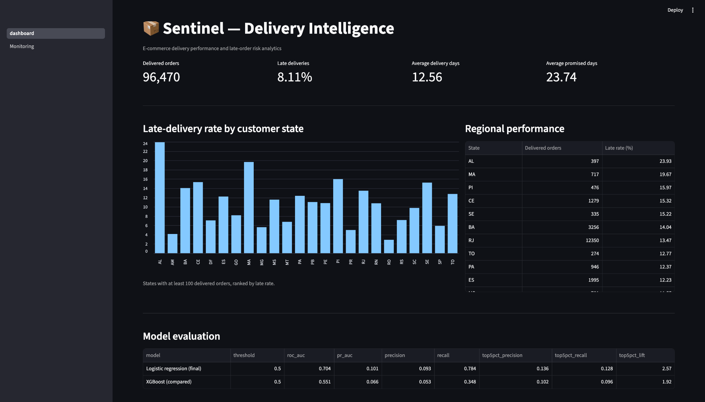
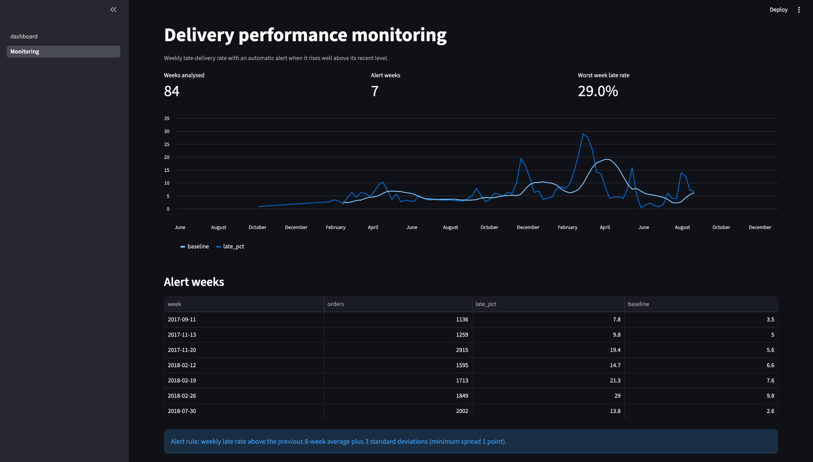

# Sentinel-lite: Delivery Intelligence

[](https://github.com/NadavaluruSashank/sentinel-lite/actions/workflows/ci.yml)

An end-to-end data project on the public Olist Brazilian e-commerce dataset: a SQL data layer, a late-delivery risk ranking model, a scoring API, and a dashboard that monitors weekly delivery performance.

> Independent portfolio prototype. It uses **public Olist data only**: no data from Telyport or any employer. It runs locally and is not a production deployment.

## Problem statement

Some orders arrive after the delivery date promised to the customer. If an operations team could rank open orders by their risk of being late, it could look at the riskiest ones first. This project asks: using only information available when the order is placed, how well can late deliveries be ranked, and how should that be evaluated honestly over time?

## Summary

- **Data:** 96,470 delivered orders, 8.11% delivered late (public Olist dataset).
- **What I built:** PostgreSQL + SQL views, a logistic-regression risk ranking, a FastAPI scoring endpoint, and a Streamlit dashboard with weekly late-rate monitoring.
- **Result:** on a chronological holdout, the 5% of orders ranked riskiest were **2.57x** more often late than the test-period average (ROC-AUC 0.704).
- **Finding:** late deliveries come in spikes, not evenly. The weekly late rate is typically 3 to 6% but reached 19.4% in the week of 2017-11-20 and 29.0% in the week of 2018-02-26.
- **Honest take:** this is a modest ranking model, not a production alerting system. The score is not a calibrated probability.

## Dataset

- **Source:** [Brazilian E-Commerce Public Dataset by Olist](https://www.kaggle.com/datasets/olistbr/brazilian-ecommerce) on Kaggle (real, anonymised marketplace orders from 2016–2018, published by Olist). Check the Kaggle page for the licence terms.
- **Used here:** 96,470 delivered orders (status `delivered` with a recorded delivery date), built with the `delivered_orders` SQL view in `sql/01_views.sql`.
- **Target:** late = delivered after the estimated delivery date. 8.11% of these orders were late.
- Raw CSVs are not stored in this repository; download them from Kaggle (see *Run locally*).

## How it fits together

```
Olist CSVs -> PostgreSQL (delivered_orders view) -> src/train_final.py -> models/
                       |                                                  |
                       v                                                  v
          Streamlit dashboard + monitoring                      FastAPI  POST /score
```

## Dashboard

KPIs and late-delivery rate by customer state.



## Weekly monitoring

Flags weeks where the late rate exceeds the previous 8-week average plus 3 standard deviations. The screenshot shows 7 alert weeks and a worst week of 29.0%. These are descriptive historical results, not forecasts.



## API

- `GET /health` returns API status and the alert threshold.
- `POST /score` returns a risk score and whether it triggers the alert.

Interactive docs at `http://localhost:8000/docs`. Example request:

```json
{
  "customer_state": "AL",
  "seller_state": "SP",
  "total_price": 120,
  "total_freight": 35,
  "promised_days": 20,
  "purchase_dow": 2,
  "purchase_hour": 14,
  "distance_km": 2200
}
```

In two manual checks, this long-route order scored 0.954 (alert), while a short local order scored 0.135 (no alert). That confirms the request flow and the direction of the ranking. It does not prove model quality.

## Evaluation

Orders are split by time, never randomly:

| Block | Use |
|---|---|
| Oldest 50% | Only to compute seller history features |
| Next 30% | Training |
| Newest 20% (19,294 orders) | Test |

The test period has a lower late rate (5.3%) than the training period (12.7%), which makes it a deliberately hard test.

| Model | ROC-AUC | Top-5% precision | Top-5% lift |
|---|---|---|---|
| Logistic regression (final) | 0.704 | 13.6% | 2.57x |
| XGBoost (compared) | 0.551 | 10.2% | 1.92x |

"Top-5% lift": among the 5% of test orders the model ranks riskiest, late deliveries were 2.57 times more frequent than across all test orders.

**Lessons from the iterations** (earlier scripts are kept in `experiments/`):
- A first version of the seller-history feature used leave-one-out encoding, which leaks the target and made results look worse on the test set. It was replaced by seller history computed from an earlier time block.
- XGBoost overfit the training period; the simpler logistic regression generalised better, so it is the final model.

## Limitations

- ROC-AUC 0.70 means the model ranks risk only somewhat better than chance.
- Late deliveries here seem driven largely by period-specific events that order features cannot capture.
- Single chronological split on one public dataset; no probability calibration. Further temporal validation would be needed before any operational use.
- Lift is a ranking measure. It is not evidence of reduced delays or cost savings.

## Run locally

Assumes Python dependencies installed and Docker Desktop running. Raw data and trained models are not stored in Git.

1. Start PostgreSQL: `docker compose up -d db`
2. Download the Olist CSV files from Kaggle into `data/raw/`, then:

```bash
   source .venv/bin/activate
   python src/load_data.py
   docker compose exec -T db psql -U sentinel -d olist < sql/01_views.sql
```

3. Train and save the model and metrics: `python src/train_final.py`
4. Start the API: `uvicorn app.api:app --reload --port 8000`
5. Start the dashboard: `python -m streamlit run app/dashboard.py` (opens at `http://localhost:8501`)

The database login in the code is the local demo default (`sentinel`).

## Tests and CI

GitHub Actions runs `ruff` and `pytest` on every push and pull request (`.github/workflows/ci.yml`). The tests cover the feature logic (distance, derived features, column alignment), the weekly alert rule, and the API endpoints. API tests use a small stand-in model, so CI needs neither Postgres nor the trained model.

```bash
pip install -r requirements-dev.txt
ruff check .
pytest
```

## Repository layout

```
app/          FastAPI service and Streamlit dashboard (+ monitoring page)
sql/          delivered_orders view
src/          data loading, final training script, shared feature logic
tests/        pytest suite run in CI
experiments/  earlier training iterations, kept for transparency
docs/         screenshots
```

## Stack

Python, pandas, NumPy, scikit-learn, XGBoost, PostgreSQL / SQL, FastAPI, Streamlit, Docker Compose (database).

## Next steps

Probability calibration, rolling re-validation over more time windows, and containerising the API and dashboard.

## Author

**Nadavaluru Sashank** · Data Scientist · MSc Data Science & AI, DSTI School of Engineering, Paris
[Portfolio](https://nadavalurusashank.github.io/Portfolio_website/) · [LinkedIn](https://www.linkedin.com/in/sashank-nadavaluru-425617270) · [GitHub](https://github.com/NadavaluruSashank)
