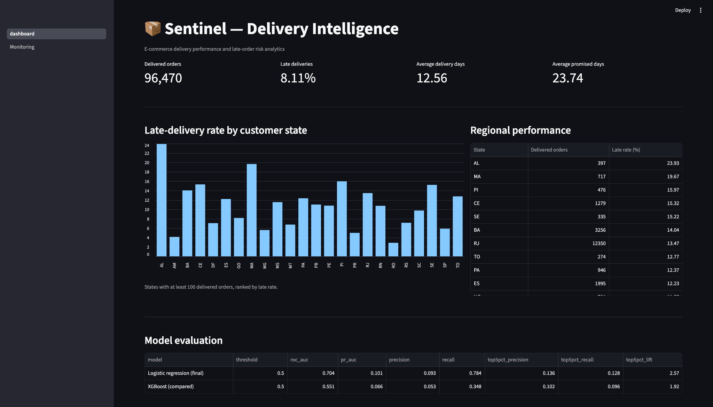
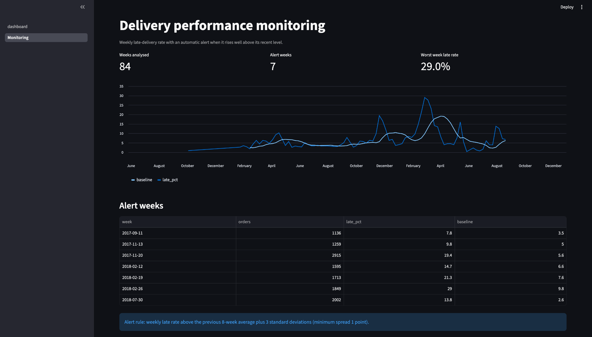

# Sentinel-lite: Delivery Intelligence

An end-to-end data project on the public Olist Brazilian e-commerce dataset: a SQL data layer, a late-delivery risk ranking model, a scoring API, and a dashboard that monitors weekly delivery performance.

## Summary

- **Data:** 96,470 delivered orders, 8.11% delivered late (public Olist dataset).
- **What I built:** PostgreSQL + SQL views, a logistic-regression risk ranking, a FastAPI scoring endpoint, and a Streamlit dashboard with weekly late-rate monitoring.
- **Result:** on a chronological holdout, the 5% of orders ranked riskiest were **2.57x** more often late than the test-period average (ROC-AUC 0.704).
- **Finding:** late deliveries come in spikes, not evenly. The weekly late rate is typically 3 to 6% but reached 19.4% in the week of 2017-11-20 and 29.0% in the week of 2018-02-26.
- **Honest take:** this is a modest ranking model, not a production alerting system. The score is not a calibrated probability.

## How it fits together

```
Olist CSVs -> PostgreSQL (delivered_orders view) -> src/train_final.py -> models/
                       |                                                  |
                       v                                                  v
          Streamlit dashboard + monitoring                      FastAPI  POST /score
```

## Dashboard

KPIs and late-delivery rate by customer state.



## Weekly monitoring

Flags weeks where the late rate exceeds the previous 8-week average plus 3 standard deviations. The screenshot shows 7 alert weeks and a worst week of 29.0%. These are descriptive historical results, not forecasts.



## API

- `GET /health` returns API status and the alert threshold.
- `POST /score` returns a risk score and whether it triggers the alert.

Interactive docs at `http://localhost:8000/docs`. Example request:

```json
{
  "customer_state": "AL",
  "seller_state": "SP",
  "total_price": 120,
  "total_freight": 35,
  "promised_days": 20,
  "purchase_dow": 2,
  "purchase_hour": 14,
  "distance_km": 2200
}
```

In two manual checks, this long-route order scored 0.954 (alert), while a short local order scored 0.135 (no alert). That confirms the request flow and the direction of the ranking. It does not prove model quality.

## Evaluation

Orders are split by time, never randomly:

| Block | Use |
|---|---|
| Oldest 50% | Only to compute seller history features |
| Next 30% | Training |
| Newest 20% (19,294 orders) | Test |

The test period has a lower late rate (5.3%) than the training period (12.7%), which makes it a deliberately hard test.

| Model | ROC-AUC | Top-5% precision | Top-5% lift |
|---|---|---|---|
| Logistic regression (final) | 0.704 | 13.6% | 2.57x |
| XGBoost (compared) | 0.551 | 10.2% | 1.92x |

"Top-5% lift": among the 5% of test orders the model ranks riskiest, late deliveries were 2.57 times more frequent than across all test orders.

**Lessons from the iterations** (earlier scripts are kept in `experiments/`):
- A first version of the seller-history feature used leave-one-out encoding, which leaks the target and made results look worse on the test set. It was replaced by seller history computed from an earlier time block.
- XGBoost overfit the training period; the simpler logistic regression generalised better, so it is the final model.

## Limitations

- ROC-AUC 0.70 means the model ranks risk only somewhat better than chance.
- Late deliveries here seem driven largely by period-specific events that order features cannot capture.
- Single chronological split on one public dataset; no probability calibration. Further temporal validation would be needed before any operational use.
- Lift is a ranking measure. It is not evidence of reduced delays or cost savings.

## Run locally

Assumes Python dependencies installed and Docker Desktop running. Raw data and trained models are not stored in Git.

1. Start PostgreSQL: `docker compose up -d db`
2. Download the Olist CSV files from Kaggle into `data/raw/`, then:

```bash
   source .venv/bin/activate
   python src/load_data.py
   docker compose exec -T db psql -U sentinel -d olist < sql/01_views.sql
```

3. Train and save the model and metrics: `python src/train_final.py`
4. Start the API: `uvicorn app.api:app --reload --port 8000`
5. Start the dashboard: `python -m streamlit run app/dashboard.py` (opens at `http://localhost:8501`)

The database login in the code is the local demo default (`sentinel`).

## Repository layout

```
app/          FastAPI service and Streamlit dashboard (+ monitoring page)
sql/          delivered_orders view
src/          data loading and final training script
experiments/  earlier training iterations, kept for transparency
docs/         screenshots
```

## Stack

Python, pandas, NumPy, scikit-learn, XGBoost, PostgreSQL / SQL, FastAPI, Streamlit, Docker Compose (database).

## Next steps

Probability calibration, rolling re-validation over more time windows, and containerising the API and dashboard.
